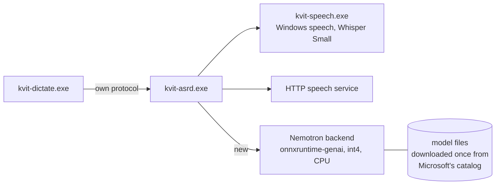

# Copilot's local speech model, and whether kvit-dictate can use it

Investigated 2026-11-23, on Aorus (Intel i7-14700K, CPU only, no GPU), where the agent's shell
runs. The Threadripper work PC was not reachable, so nothing here was measured on it.

**Short answer: yes.** The model Copilot downloads is NVIDIA's *Nemotron Speech Streaming 0.6B*.
Microsoft packages it as ONNX (int4) in its **Foundry Local** model catalog, the same catalog
VS Code and Copilot CLI download from. kvit-dictate can download the same files from the same
place and run them on the CPU with **onnxruntime-genai**, Microsoft's open-source (MIT) runtime.
That needs no server, no Python and no experimental Windows API. On this PC it decodes about
eight times faster than real time and supports a live preview, which **This PC** mode (Windows
speech) does not have.

---

## 1. What Copilot uses

| Product | Model | Runtime | Source |
|---|---|---|---|
| VS Code chat dictation | `nemotron-3.5-asr-streaming-0.6b` (multilingual), setting `dictation.model` | Foundry Local | [VS Code voice docs][vsc] |
| Copilot CLI `/voice` | picker: `nemotron-3.5-asr-streaming-0.6b`, `nemotron-speech-streaming-en-0.6b`, `nemotron-speech-streaming-es-0.6b` | Foundry Local (bundled `foundry-local-core`, `onnxruntime-genai`) | [copilot-cli #4024][cli] |

According to a user report in [vscode #332537][vscissue] (not verified here), VS Code keeps its
copy in `%APPDATA%\Code\chatDictationModels\` and its runtime in
`%APPDATA%\Code\chatDictationRuntime\<version>\`. Neither copy exists on Aorus: VS Code 1.146.0
is installed but has never downloaded the dictation model, and Copilot CLI is not installed.

## 2. The catalog

Listed with `foundry-local-sdk` 2.5.0 (Python). Every speech model it offers runs on the CPU:

| Catalog id | Size | Kind | License label |
|---|---|---|---|
| `nemotron-speech-streaming-en-0.6b-generic-cpu:3` | 696 MB | streaming, English | MIT |
| `nemotron-3.5-asr-streaming-0.6b-generic-cpu:3` | 756 MB | streaming, 40 languages | MIT |
| `nemotron-speech-streaming-es-0.6b-ft-generic-cpu:1` | 729 MB | streaming, Spanish | MIT |
| `parakeet-tdt-0.6b-v2-generic-cpu:1` | 692 MB | whole-utterance, English | MIT |
| `openai-whisper-{tiny,base,small,medium,large-v3-turbo}-generic-cpu` | 131–1284 MB | whole-utterance | apache-2.0 |

The files are hosted in Azure ML's public registry
(`azureml://registries/azureml/models/<id>/versions/<n>`). The English Nemotron model downloaded
in **17 s**. It contains `encoder.onnx` with its 687 MB of weights, `decoder.onnx`, `joint.onnx`,
`silero_vad.onnx`, a tokenizer and `genai_config.json`, and is built for 560 ms chunks. `LICENSE`
is MIT, covering Microsoft's packaging. `NOTICES` says the weights are under the
[NVIDIA Open Model License][nvol], which allows commercial use.

## 3. Measured

Five real sessions from `H:\kvit-corpus`, lasting 4.6, 10.1, 22.2, 25.6 and 44.5 s.

| Route | Result |
|---|---|
| **onnxruntime-genai alone**, Nemotron English, Windows power throttling off | **71–77 ms per 560 ms chunk**, the same from the first chunk to the last of a 44.5 s session, or **0.13× real time**. Model load 0.70 s. |
| The same, power throttling left on | 72–77 ms per chunk for about the first 2.5 s of work, then **240–400 ms** for every chunk after that, including in later sessions |
| Foundry Local runtime, Nemotron English, audio fed at microphone pace | Text was complete **298–388 ms after the last audio** (4.6, 10.1 and 22.2 s sessions). The first partial result arrived at 1.9–2.5 s. |
| Foundry Local runtime, Parakeet TDT, whole utterance | 4.6 s → 0.82 s, 10.1 s → 2.2 s, 22.2 s → 5.8 s, 25.6 s → 6.9 s, or 0.18–0.27× real time |
| *Reference:* Windows speech (Whisper Small), from `tools/kvit-speech/README.md`, same CPU model | 5 s → 2.98 s, roughly 1350 ms + 0.30× real time, with no live preview |

The Foundry and Parakeet rows were measured before the throttling was found, so they are
probably slower than these models can run.

**What the throttling is.** Windows applies power throttling (EcoQoS) to a process that has no
window and is not in the foreground. On a hybrid Intel CPU it moves the work to the efficiency
cores. That costs this model a factor of four. The fix is one call,
`SetProcessInformation(ProcessPowerThrottling)` with execution-speed throttling switched off.
`kvit-asrd` and `kvit-speech` are both window-less processes, so the **Windows speech path may be
throttled in the same way**. That could be part of why it is slow on the Threadripper. Since
2026-11-23 `kvit-asrd` makes that call for itself and for the `kvit-speech` it starts
(`src/asrd/power.h`). Whether that speeds up Windows speech has not been measured.

**Text quality.** There is no word error rate, because the corpus has no written reference
transcripts. Compared with what Qwen3-ASR wrote for the same sessions, Nemotron produced almost
the same words. It also keeps fillers such as "uh" and "um", leaves names lowercase ("Github",
"nexus"), and leaves out most commas and some full stops. Parakeet's punctuation is closer to
Qwen's. It also kept some fillers and dropped one word. The corpus text itself is not quoted here
(plan.md §1.9).

## 4. Reuse Copilot's copy, or download our own?

**Download our own copy from the same catalog.** It is the same set of files, it is under 700 MB,
and it downloaded in 17 s here. Copilot's folders are private to Copilot and change between
versions: manual installs broke when VS Code's runtime moved from 1.2.3 to 2.0.1
([vscode #332537][vscissue]). Looking for an existing Copilot copy first, to skip the download,
is optional and would be fragile.

## 5. What affects the README's "No telemetry"

1. **The Foundry Local runtime reports usage to Microsoft.** `foundry_local.dll` contains
   Microsoft's 1DS telemetry client and the endpoint
   `https://mobile.events.data.microsoft.com/OneCollector/1.0/`. With its telemetry switch off, its
   own log message reads *"non-essential 1DS upload disabled (ProcessInfo still uploads)"*. That
   event carries the app name, the OS, the CPU architecture and the process name. This was read
   from the DLL's text and was not confirmed with a network capture. **So kvit-dictate does not
   ship the Foundry runtime.**
2. **onnxruntime-genai reports usage too, but it can be switched off completely.**
   `onnxruntime-genai.dll` (NuGet 0.20.0) contains the same 1DS uploader. Its header,
   `ort_genai_c.h`, says that `ORT_DISABLE_TELEMETRY=1`, set before initialisation, "prevents the
   uploader, events, and persistent device identifier from being created for the process
   lifetime". Measured with a watch on each process's TCP connections, polled every 200 ms:

   | Process, with the model loaded and one recording decoded | Outside connections |
   |---|---|
   | Python with onnxruntime-genai, switch **not** set (run twice) | one HTTPS connection each time, to `4.150.223.103` and to `74.151.238.139` (Azure) |
   | the same, with `ORT_DISABLE_TELEMETRY=1` | none |
   | `kd_tests --suite asrd_nemotron`, the translator's code, which sets the switch itself | none, only its own loopback test connections, over 49 s |

   The two addresses did not resolve back to a name, so their being the 1DS collector is
   inferred, not confirmed.
3. **The registry download needs no Foundry.** `foundry_local.dll` names the registry's anonymous
   endpoint: `https://eastus.api.azureml.ms/modelregistry/v1.0/registry/models/nonazureaccount?assetId=azureml://registries/azureml/models/<id>/versions/<n>`.
   It answers with a read-only blob container address (`blobSasUri`) and the folder (`v3`), and
   each file is then a plain HTTPS GET. The registry's `Content-MD5` for every file matched the
   copy Foundry had downloaded.

## 6. What was built (2026-11-23)

The translator, `kvit-asrd`, now has `--backend nemotron`, and since the same day it is what **This PC** in Settings runs. Windows speech, and its `kvit-speech` helper, are removed (§9).

| Piece | File |
|---|---|
| The backend. It loads `onnxruntime-genai.dll` at run time from `nemotron\` beside the exe, sets `ORT_DISABLE_TELEMETRY` first, and decodes each 560 ms chunk on a worker thread as the audio arrives | `src/asrd/backend_nemotron.h`, `.cpp` |
| The download, straight from the registry. Every file's size and SHA-256 is pinned in the code; it downloads into `<dir>.partial` and is renamed only when every file checks out. Shared by Settings and `kvit-asrd --nemotron-download` | `src/model_download.h`, `.cpp` |
| The power throttling opt-out, for `kvit-asrd` | `src/asrd/power.h`, `.cpp` |
| Command line: `--backend nemotron`, `--nemotron-runtime DIR`, `--nemotron-model DIR`, `--nemotron-install-model`, `--nemotron-download` | `src/asrd/main.cpp` |
| Tests | `tests/test_asrd_nemotron.cpp` |

The model goes to `%LOCALAPPDATA%\kvit-dictate\models\nemotron-speech-streaming-en-0.6b-v3`, so an
upgrade or an uninstall does not throw it away. `ready` says `native-streaming` with
`chunk_ms` 560. The model's own VAD is switched off: on one corpus session it dropped a word
that the session's endpointer had kept.

**Checked on this PC:**

* `kvit-asrd --nemotron-download` fetched all 14 files (728 MB) in 82 s, and every one matched
  its pin. The first attempt failed with WinHTTP error 12044: the registry asks for an optional
  TLS client certificate, and the code now answers "none" and sends again.
* `kd_tests --suite asrd_nemotron`: 10 tests pass with the real model. On a 22.2 s corpus
  session, fed at microphone pace, there were 21 live updates and the final arrived 280 ms after
  the last audio. Over the WebSocket, as the app would connect, there were 19 partials, one
  final and no errors. A 4.6 s session gave 4 updates and a final 563 ms after its last audio.
  The test process does not opt out of throttling, so these delays are probably on the high side.
* The full suite passes: 754 tests, 0 failed.

The Settings button, the installer and the removal of Windows speech are §9.

## 7. How it fits

* It is a third backend in `kvit-asrd`, next to `src/asrd/backend_windows.h`, and it runs inside
  that process. `tools/nemotron-probe/time_nemotron.py` is the same decoding loop in Python.
* It adds about 33 MB of DLLs (`onnxruntime.dll` 20.6 MB and `onnxruntime-genai.dll` 10.3 MB
  from NuGet, plus the C++ runtime), against the roughly 200 MB that `kvit-speech` ships now.
* It streams natively, so the pill can show text while the user speaks.
* It is what `bench/CANDIDATES.md` §4 already planned. That section picked Nemotron streaming as
  the streaming finalist, and kept this int4 onnxruntime-genai export "in reserve … Revisit in
  Phase 5 if a CPU-only build becomes interesting". A work PC with no GPU server is that case.
* Each 560 ms chunk must be decoded in under 560 ms, or dictation falls behind. That margin is 7×
  on this PC and is unknown on the Threadripper. The Threadripper's Zen 4 cores have AVX-512, and
  onnxruntime chooses its CPU code at run time. No equivalent of the Windows model's VNNI crash
  (`tools/kvit-speech/VnniWorkaround.cs`) is known for onnxruntime, but that is unverified.

## 8. How this was run

Scratch environments were kept outside the repo, in
`%LOCALAPPDATA%\Temp\kvit-nemotron-probe\`: one venv each for `foundry-local-sdk` 2.5.0 and
`onnxruntime-genai` 0.20.0, plus the downloaded models and packages. That folder, 3.4 GB by the
end, was deleted on 2026-11-24, so repeating any of this starts with a fresh download. The
onnxruntime-genai measurement can be repeated with `tools/nemotron-probe/time_nemotron.py`. It
switches power throttling off for its own process, and `--throttled` leaves it on. The
throttling was seen when the script ran from the agent's shell, which has no window.

## 9. This PC is Nemotron; Windows speech is removed (2026-11-23)

Asked for after §6: drop Windows speech entirely, and let Settings download the model, so that
the installer and one button are the whole setup.

* **Settings → Server.** The third choice reads **This PC: Nemotron, no server**. The right column
  starts with *Speech model on this PC*: a **Download Nemotron model (728 MB)** button and a line
  that counts the megabytes as they arrive. Closing the dialog stops the download, and pressing
  the button again carries on from the first file not yet complete. The button turns into
  *Nemotron model downloaded* once all 14 files are in place. Test on This PC refuses with that
  instruction until the model is there, then starts a private `kvit-asrd --backend nemotron` and
  waits for `ready`. Live preview is offered on This PC now; Windows speech could not keep up
  with it. The stored setting is still `this-pc`, so existing settings files move to Nemotron.
* **Removed:** `src/asrd/backend_windows.*`, `tools/kvit-speech/` (the C# helper, with its VNNI
  workaround), `tests/test_asrd_windows.cpp`, `tests/fake_speech/`, the session tests that used
  it, the Python server's `windows_speech` backend and its tests, the two `windows-speech` entries
  in `models.json`, and `--backend windows-speech`, `--speech-helper` and
  `--speech-install-model` on the translator.
* **Installer.** `packaging/windows/build-release.ps1` no longer needs the .NET SDK. It fetches
  `Microsoft.ML.OnnxRuntimeGenAI` 0.20.0 and `Microsoft.ML.OnnxRuntime` 1.32.0 from NuGet,
  refuses either if its SHA-256 differs from the pin, and stages `onnxruntime-genai.dll`,
  `onnxruntime.dll`, `onnxruntime_providers_shared.dll`, their licences, and five Visual C++
  runtime DLLs from the local Visual Studio into `nemotron\`. The installer deletes an old
  `kvit-speech\` folder on upgrade.

**Checked on Aorus (i7-14700K):**

* `build-release.ps1 -SkipTests` ran through: 21 files staged, 33.4 MB; the installer is now
  10.5 MB and the ZIP 13.7 MB, against 62 MB for the installer with `kvit-speech`. The script's
  first two runs failed to find the C++ runtime folder because vswhere does not list this
  machine's VS 2022; it now takes the folder from CMake's `CMAKE_GENERATOR_INSTANCE`.
* The Release `kd_tests --suite asrd_nemotron`, pointed at the staged `build-stage\nemotron\`,
  passes: 10 tests; over the WebSocket 19 partials and one final with no errors; the final 285 ms
  after the last audio of a 22.2 s session.
* Debug suite: 736 tests pass. Python server suite: 448 of 449 pass; the one error is
  `test_stability_fixtures` needing `pytest`, which `C:\Python312` lacks, and it was there before.
  Bench suite: 149 pass.

**Not checked:** the Settings page has not been looked at on screen, so its layout, the
download button and the progress line are unseen; a live dictation through the installed app;
the Settings download itself (the same code as `kvit-asrd --nemotron-download`, which was run);
and any machine other than Aorus.

[vsc]: https://code.visualstudio.com/docs/configure/accessibility/voice
[cli]: https://github.com/github/copilot-cli/issues/4024
[vscissue]: https://github.com/microsoft/vscode/issues/332537
[nvol]: https://www.nvidia.com/en-us/agreements/enterprise-software/nvidia-open-model-license/
