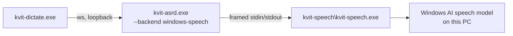

# Release audit, 2026-11-19

Two questions: can kvit-dictate be released as an open-source Windows installer that dictates
through Windows' own speech API with no server, and does the repository hold anything that must
not be public.

## 1. On-device dictation through Windows: not in the installer (built since; see the update)

What the installer ships today (`packaging/windows/kvit-dictate.iss`, built as
`dist/kvit-dictate-1.0.0-setup.exe` on 2026-11-08) is `kvit-dictate.exe` plus `kvit-asrd.exe`.
`kvit-asrd` has one backend, OpenAI-compatible HTTP (`src/asrd/backend_openai.cpp`). So an
installed copy recognises nothing without a speech server somewhere. The README says so in its
first lines, and `release-plan.md` §0 and `openai-translator.md` §1.4 put on-device dictation out
of v1 on purpose.

The installed copy on Aorus (`%LOCALAPPDATA%\Programs\kvit-dictate`, running) is pointed at
`http://strixhalo.lan:10301`, model `Qwen/Qwen3-ASR-1.7B`.

The on-device work exists, outside the shipped path:

| Piece | Where | State |
|---|---|---|
| C# helper around `Microsoft.Windows.AI.Speech` (Whisper Small, int8) | `tools/kvit-speech/` | built and measured 2026-08-21 |
| Backend that drives the helper | `server/kvit_asr/backends/windows_speech.py` (Python reference server) | used for real dictation in the developer setup |
| Backend in the shipped translator | `src/asrd/` | **missing** |
| Helper in the installer | `packaging/windows/` | **missing** |

What shipping it costs, from `tools/kvit-speech/README.md` and `KvitSpeech.csproj`:

* **The API is experimental.** It exists only in Windows App SDK `2.3.2-experimentala`; no stable
  release has it. Microsoft does not support experimental releases in production, and the API
  can change or vanish with any update.
* **It works without package identity only through a workaround**: the helper puts the model's
  DLL folder on the search path itself. A Windows update can break this, and the symptom would be
  `0x8007007E`.
* **Size and runtime.** The helper folder is about 200 MB, and it needs the .NET 9 runtime on the
  machine (`SelfContained` is false), so the installer must bundle .NET or require it.
* **Windows version.** It targets build 26100 (Windows 11 24H2). The README's "Windows 10 (1809+)"
  would not hold for this path.
* **The model is an optional Windows component.** Copilot+ PCs have it; other PCs download it
  through Windows Update, which the helper only starts when asked (`--ensure-model`).
* **Speed.** About 1.35 s fixed plus 0.3× real time per utterance on an i7-14700K, CPU only:
  roughly 3 s for 5 s of speech, against about 0.55 s from the LAN server. It also invents text
  over silence, so the VAD gate is required.

### Update, later on 2026-11-19: built

| Piece | Where | State |
|---|---|---|
| Backend in the shipped translator | `src/asrd/backend_windows.{h,cpp}`, `src/asrd/backend.h` | done: one helper per process, kept across connections; silence gate; cancel without shifting answers; restart after a crash or a hang |
| Choice in Settings → Server | third radio, "This PC: Windows speech, no server" (`server.mode = "this-pc"`) | done; address, model, key and live preview are greyed out in that mode |
| Model download | the Test button in This PC mode passes `--speech-install-model` | done; a dictation never downloads |
| Helper in the installer | `packaging/windows/build-release.ps1` publishes it self-contained into `kvit-speech\` | done: 231 MB staged, installer 62 MB, ZIP 92 MB |

Checked: Debug and Release builds with warnings as errors, 28 of 28 test suites (18 new cases
against a fake helper in `tests/fake_speech`, which fails in each way the real one can). Real
speech — a sentence made with Windows text-to-speech — went through the real client, translator
and the packaged helper and came back word for word. The staged `kvit-asrd.exe` found the helper
beside itself and reported ready in 2.8 s to `kd_probe`, the Test button's twin.

Not checked: the Settings page on screen, the installer on any machine, and a PC whose model is
not yet installed (the download path through Test). New installs still start in "speech service"
mode with an empty address.

Release blockers that hold either way (README "Status"): not code-signed, no clean-VM install
test, `docs/supported-targets.md` measured in 11 of 162 cells.

## 2. Secrets: none found

Checked: the full patch history of every commit on every branch (181 commits, 11.6 MB of
`git log -p --all`), including the three files that were later deleted (`handover.md`,
`plan-review.md`, `run-server.bat`), and the largest blobs. Searched for OpenAI/OpenRouter, AWS,
GitHub, Slack, Google, Hugging Face keys, JWTs, PEM private keys, `Bearer` headers and
key/password/token assignments. This was a pattern search, not a dedicated scanner such as
gitleaks.

* Every API key in history is a test placeholder (`sk-or-v1-0123456789abcdef`,
  `sk-or-v1-test-…`, `sk-or-v1-wrong`). The real key lives DPAPI-encrypted in
  `%LOCALAPPDATA%\kvit-dictate\settings.json`, outside the repository.
* No audio and no dictated text is committed. `.gitignore` excludes `*.wav`, `bench/corpus/`,
  logs and transcripts, and each `bench/results/ab/<run>/` ignores everything but its aggregate.
  The committed aggregates hold no transcript text. The ignored transcripts are still on disk in
  the main checkout (`bench/results/ab/*/clips.jsonl`, `adjudicate.md`).

## 3. Not secret, but personal, and public once pushed

Published 2026-11-19 as `kvit-s/kvit-dictate` (see `docs/publish-github.md`).

| What | Where | Weight |
|---|---|---|
| A former work address as author | 92 commits' author line (87 more use `info@kvit.app`) | done: history rewritten before publishing, every commit now `Kvit <info@kvit.app>` or `Kvit Agent` |
| Home network names: `strixhalo.lan`, `192.168.138.186` | 119 mentions in history; the Settings URL example (`src/settings.cpp:2445`, `:2527`); default in `server/kvit_asr/backends/openai_http.py:98`; `models.json` | the Settings example is shown to every user and should be generic |
| Local paths: `C:\Users\sk`, `D:\projects\wan-dancer`, `H:\kvit-corpus` | code comments, `server/kvit_asr/backends/*.py`, bench aggregates | low |
| Working notes about your own setup | `progress.md`, `plan.md`, `openai-translator.md`, `prd.md` | a choice: keep as design history or move out |
| `.claude/` and `.kvit/` not listed in `.gitignore` | ignored here only by their own rules | done: both are in the root `.gitignore` |
